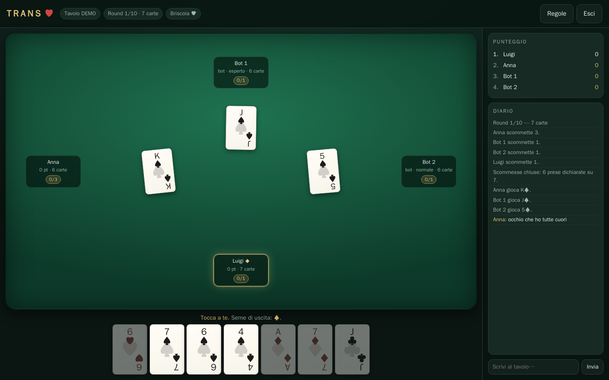
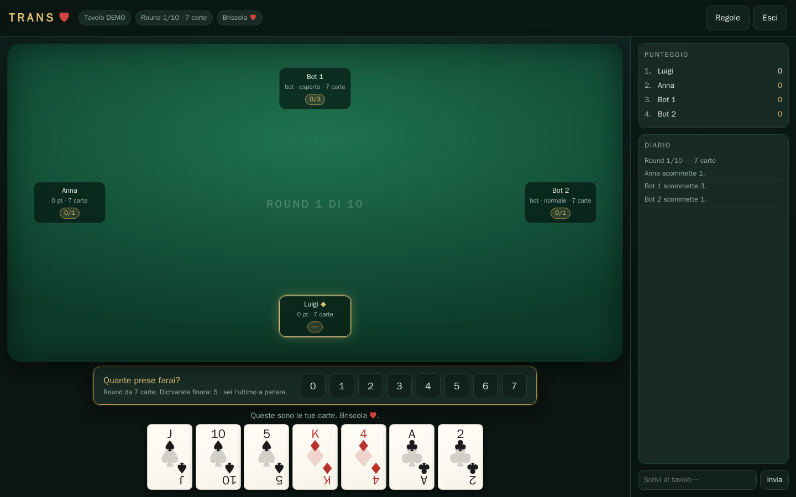

# Dichiaro

> **T**ra **R**e e **A**sso, **N**on **S**bagliare: il nome con cui è nato questo gioco, TRANS.

[](https://github.com/dantonioluigi/trans-card-game/actions/workflows/ci.yml)
[](https://github.com/dantonioluigi/trans-card-game/actions/workflows/release.yml)

Gioco di carte a **prese e dichiarazioni**: una via di mezzo fra briscola e tresette,
dove il punto non è prendere tanto, ma prendere **esattamente quanto avevi detto**.

Multiplayer online (basta un link) oppure da soli contro i bot. Niente account,
niente installazioni per chi gioca: si apre il browser e si entra con un codice a 4 lettere.

### 🎴 [Si gioca qui →](https://dantonioluigi.github.io/trans-card-game/)

Quella è la versione **senza server**: apri una stanza, passi il link, e le carte
viaggiano da browser a browser. Se invece vuoi ospitarti la partita per conto tuo,
nel repo c'è il server Python completo — vedi [Dove farlo girare](#dove-farlo-girare).



---

## Le regole

**Il mazzo.** 52 carte francesi, niente jolly.
Valori: `2 < 3 < … < 10 < J < Q < K < A`. La **briscola è sempre cuori ♥**.

**La presa.** Chi esce sceglie il seme. Sei **obbligato a rispondere a quel seme** se
ce l'hai in mano; se non ce l'hai giochi quello che vuoi, briscola compresa.
Vince la briscola più alta, altrimenti la carta più alta del seme di uscita.
Chi prende esce nella presa successiva.

**Chi arriva tardi.** Per iniziare servono almeno due giocatori, quindi spesso si
parte con dei bot. Chi entra col codice a partita già cominciata **prende il posto
di un bot**, con le sue carte e il suo punteggio: nessuno resta fuori per aver
tardato, e chi ospita non deve restare fermo ad aspettare.

**Chi esce.** Se qualcuno chiude la scheda o perde la connessione, **al suo posto
gioca un bot** e la partita va avanti. Se rientra prima che qualcun altro si sieda
lì, il posto torna suo; altrimenti è libero per chi arriva.

**La dichiarazione.** Prima di giocare ognuno dichiara quante prese farà,
partendo da sinistra del mazziere — che quindi parla per ultimo. Si sceglie il
numero e poi si conferma: dichiarare non si disfa, un click storto sì.

**Il mazziere non può pareggiare il conto:** la somma delle dichiarazioni non
può fare esattamente il numero di prese in palio. In cinque, in un round da 5
carte, se i primi quattro dicono 1 a testa il mazziere non può dire 1: dovrà
dire 0, oppure 2 o più. Così almeno un giocatore sbaglia per forza, e chiudere
il giro diventa la posizione più scomoda del tavolo.

| Esito | Punti |
|---|---|
| Dichiari **0** e fai **0** | **10** |
| Dichiari **1** e fai **1** | **15** |
| Dichiari **2** e fai **2** | **20** |
| … e così via, +5 per ogni presa dichiarata | `10 + 5 × dichiarate` |
| **Sbagli** la dichiarazione | **1 punto per ogni presa fatta** |

Nel round **A PERDERE** non si dichiara: si pagano 5 punti per ogni presa
incassata. L'eccezione è la *luna*: chi le prende **tutte** non paga niente e
incassa **+30**. È una via di fuga stretta — sbagliarne una sola dà il peggior
punteggio del round — e infatti nelle simulazioni fra bot riesce in meno dell'1%
dei round a perdere.

Dichiarare tanto paga, ma sbagliare di una sola presa azzera quasi tutto: dire 4 e
farne 4 vale 30, dire 4 e farne 3 ne vale 3.



Si dichiara guardando le proprie carte — tranne nel round BUIO, dove restano coperte.

**I round.** Si scende di mano in mano — 7 carte a testa, poi 6, 5, 4, 3, 2, 1 —
e poi arrivano i tre round speciali, tutti da 7 carte:

| Round | Cosa cambia |
|---|---|
| **NO BRISCOLA** | Non c'è briscola. Vince sempre la carta più alta del seme di uscita. |
| **BUIO** | Dichiari **senza guardare le tue carte**. Le vedi solo dopo che hanno parlato tutti. |
| **A PERDERE** | Non si dichiara: ogni presa che incassi vale **−5 punti**. Ma chi le prende **tutte** ribalta il round e incassa **+30**. |

**Durata.**

- **Partita veloce — 10 round:** `7, 6, 5, 4, 3, 2, 1` + NO BRISCOLA, BUIO, A PERDERE.
- **Partita lunga — 20 round:** la veloce, poi la risalita `1, 2, 3, 4, 5, 6, 7`
  e di nuovo i tre speciali.

Vince chi ha più punti alla fine, e da lì si riparte con **Gioca di nuovo**: stesso
tavolo, stessa durata, punteggi da zero, senza rifare la stanza.
Si gioca da **2 a 7 giocatori**, umani o bot mescolati.
Sette è il tetto: con sette carte a testa sono 49 delle 52 del mazzo, in otto non ci si sta.

---

## Come si avvia

```bash
git clone https://github.com/<utente>/trans-card-game.git
cd trans-card-game
pip install -r requirements.txt
python -m server.main
```

Apri <http://localhost:8000>, scegli un nome e **Crea tavolo**: ti ritrovi un codice
a 4 lettere. Passalo agli altri (o usa *copia il link d'invito*), riempi i posti
vuoti con i bot e parti.

Variabili d'ambiente utili:

| Variabile | Default | A cosa serve |
|---|---|---|
| `TRANS_HOST` | `0.0.0.0` | interfaccia di ascolto |
| `TRANS_PORT` | `8000` | porta |
| `TRANS_RELOAD` | *(vuoto)* | se valorizzata, ricarica a caldo durante lo sviluppo |
| `TRANS_ALLOWED_ORIGINS` | *(vuoto)* | elenco, separato da virgole, delle pagine che possono aprire il WebSocket (es. `https://gioco.example`). Vuoto: solo pagine servite da questo stesso indirizzo |
| `TRANS_FORWARDED_IPS` | `*` | da chi fidarsi per `X-Forwarded-For`. Con `*` chiunque può falsificare il proprio IP e aggirare il tetto di connessioni per IP: dietro un proxy mettici il suo indirizzo |

Con Docker:

```bash
docker build -t trans .
docker run --rm -p 8000:8000 trans
```

---

## Modalità ufficio

In alto c'è **Modalità ufficio**: il tavolo diventa grigio con un accento viola,
le carte perdono il seme stampato al centro, niente pulsa, e la scheda si chiama
"Riepilogo attività" con un'icona neutra. Quando tocca a te il titolo diventa
"(1) Riepilogo attività", come un messaggio non letto. Se il sistema è in tema
scuro, lo segue.

**Esc due volte** la accende al volo, anche mentre scrivi in chat. La accende
soltanto: premerlo di nuovo non la spegne. La scelta resta salvata nel browser
e vale solo per te, gli altri al tavolo non vedono differenze.

---

## App Android

Un involucro [Capacitor](https://capacitorjs.com) attorno alla versione senza
server: stessa interfaccia, stessi tavoli, e chi ha l'app gioca con chi usa il
browser.

**Installarla.** Scarica l'APK dalla Release (`dichiaro-X.Y.Z.apk`) oppure, per
l'ultimo `main`, dagli *Artifacts* dell'esecuzione del workflow `android`
(Actions). Aprilo sul telefono e consenti l'installazione da quella fonte.

Senza chiavi configurate l'APK è di **debug**, firmato con la chiave di debug del
repo, che è pubblica: gli aggiornamenti si installano uno sopra l'altro, ma
chiunque potrebbe costruire un APK con la stessa firma. Va bene per passarlo agli
amici, non per altro. Per una build di rilascio imposta questi quattro segreti
del repo (Settings → Secrets and variables → Actions → Secrets):

| Segreto | Contenuto |
|---|---|
| `ANDROID_KEYSTORE_BASE64` | il keystore, in base64 (`base64 -w0 mio.keystore`) |
| `ANDROID_KEYSTORE_PASSWORD` | la password del keystore |
| `ANDROID_KEY_ALIAS` | l'alias della chiave |
| `ANDROID_KEY_PASSWORD` | la password della chiave |

Con quelli la CI produce un APK di rilascio firmato (non debuggable) e un
**AAB**, che è quello da caricare su Google Play. Il keystore lo crei una volta
(`keytool -genkeypair -v -keystore mio.keystore -alias dichiaro -keyalg RSA
-keysize 2048 -validity 10000`) e **va conservato in due posti**: se lo perdi, gli
APK installati fuori da Play non si aggiornano più (su Play, con Play App Signing,
puoi chiedere a Google di sostituire la chiave di caricamento). Non committarlo.

**Cosa cambia rispetto al sito:**

- **Serve la rete anche contro i bot**: il tavolo passa comunque dal broker
  PeerJS. L'app si apre offline, ma non si può aprire o entrare in un tavolo.
- **Il link d'invito non apre l'app.** Punta al sito pubblico, quindi chi lo
  riceve lo apre nel browser. Dentro l'app si entra col codice a 4 lettere.
- **Lo schermo resta acceso** finché sei a un tavolo. Chi ospita è l'arbitro: se
  il telefono si spegne, la partita finisce per tutti. Per lo stesso motivo
  chi ospita deve tenere l'app in primo piano.
- **Gira solo in orizzontale.** In verticale il tavolo non ci sta: lo schermo ha un
  layout apposta per i telefoni in orizzontale (tavolo e mano a sinistra, punteggio
  a destra; la chat e il diario restano nascosti). Il sito nel browser, invece,
  continua a funzionare in entrambe le posizioni.
- **Niente backup.** Sul telefono restano nome, id e segreto di rientro; il
  segreto vale per un solo dispositivo e non deve finire in un backup.
- **Il tasto indietro non fa niente**, apposta: uscire per sbaglio dal telefono
  dell'host chiuderebbe il tavolo. Dal tavolo si esce con *Esci*, dall'app con
  Home.
- **Da 4G serve il relay.** L'APK usa le stesse variabili di repo di Pages
  (`TURN_ICE_SERVERS`, `TURN_CREDENTIALS_URL`): senza, funziona solo fra
  telefoni che riescono a vedersi, di solito sulla stessa Wi‑Fi.

**Pubblicità.** L'app mostra annunci [Google AdMob](https://admob.google.com); il
sito web no (non riceve nemmeno il codice). Le regole sono fatte rispettare da
`site/js/ads.js` e provate in `site/tests/ads.mjs`:

- prima il consenso (modulo di Google, UMP, nello Spazio economico europeo, nel
  Regno Unito e in Svizzera) e solo dopo l'SDK; senza consenso non parte nessuna
  richiesta. Il pulsante *Pubblicità: le tue scelte* nella home permette di
  cambiarlo, dove la legge lo richiede;
- **mai durante una partita** e mai subito dopo un tocco su un pulsante;
- **interstitial** solo alla fine di una partita, quando la schermata dei punteggi
  è già visibile e l'utente è ancora lì; mai alla prima partita dell'installazione
  e al massimo uno ogni 5 minuti (anche dopo un riavvio dell'app);
- **App Open** solo all'avvio a freddo, prima di qualunque tocco, mai al primo
  avvio in assoluto; conta come annuncio per l'intervallo dei 5 minuti;
- un errore dell'SDK non ferma mai il gioco.

Di default escono gli **annunci di prova** di Google ("Test Ad"), che si possono
cliccare senza rischi. Gli id veri si danno con queste variabili del repo
(Settings → Secrets and variables → Actions → **Variables**) e la CI li usa
**solo per un tag di produzione** (`v1.0.0`, senza trattino): il test chiuso
(`v1.0.0-rc1`) mostra sempre annunci di prova, perché un tester che clicca
annunci veri può far sospendere l'account AdMob.

| Variabile | Esempio |
|---|---|
| `ADMOB_APP_ID` | `ca-app-pub-1234567890123456~1234567890` |
| `ADMOB_INTERSTITIAL_ID` | `ca-app-pub-1234567890123456/1111111111` |
| `ADMOB_APP_OPEN_ID` | `ca-app-pub-1234567890123456/2222222222` |

Vanno date tutte e tre, dello stesso editore: altrimenti la build si ferma. In
locale gli id veri valgono solo per una build di rilascio firmata; in debug sono
ignorati. Il plugin è `@capacitor-community/admob` **8.2.1**, fissato apposta: dalla
8.3.0 ha una dipendenza in più (`@webview-native-ui/engine`, 14 MB) che a noi non
serve; se Dependabot propone un aggiornamento, guarda cosa porta dentro. Anche
la versione dell'SDK di Google (`play-services-ads` 25.4.0) è fissata da
`app/build.sh`. Il testo dell'informativa sulla privacy è `site/privacy.html`.

**Costruirlo a mano:**

```bash
bash app/build.sh        # → app/dichiaro-1.0.0.apk (debug)

# di rilascio, con la tua chiave: APK firmato e AAB per Play
ANDROID_KEYSTORE=mio.keystore ANDROID_KEYSTORE_PASSWORD=… \
ANDROID_KEY_ALIAS=dichiaro ANDROID_KEY_PASSWORD=… bash app/build.sh
```

Servono Python 3, Node ≥ 22, JDK 21 e l'Android SDK con le licenze accettate.
`VERSION_NAME` e `VERSION_CODE` si passano come variabili d'ambiente; il codice
deve crescere perché Android accetti l'APK sopra quello vecchio (la CI usa l'ora).

Il sito è lo stesso di Pages, costruito con `python site/build.py --app`: il link
d'invito punta al sito pubblico invece che a `https://localhost`. Il progetto Android non è nel
repo, lo genera `cap add android` da `app/package.json` e
`app/capacitor.config.json`; se un giorno servirà codice nativo si toglie
`app/android/` dal `.gitignore` e si committa.

---

## Dove farlo girare

Ci sono due modi di far girare Dichiaro, e fanno cose diverse.

### Senza server, su GitHub Pages

È la versione pubblicata: motore, regole e bot girano **dentro il browser**, e
i giocatori si collegano fra loro in WebRTC. Chi apre la stanza fa da arbitro
per tutti; il link contiene il codice del tavolo. Nessun processo da tenere
acceso, nessun costo.

Due cose che non sono gratis, e vanno sapute:

- **Chi apre la stanza deve restare collegato.** Se chiude la scheda, la partita
  finisce per tutti. Non c'è nessun altro che tenga lo stato.
- **Serve un intermediario per la presentazione fra i browser.** Dichiaro usa il
  broker pubblico di PeerJS. Se è giù, o se la rete che stai usando blocca quel
  tipo di collegamento (capita in azienda), il gioco lo dice entro dodici
  secondi invece di restare lì. In quel caso puoi puntare a un broker tuo:
  imposta la variabile di repo `BROKER_URL` (`https://tuo-broker`), e
  [peerjs-server](https://github.com/peers/peerjs-server) è un container da due
  righe. Si imposta in pubblicazione e non nell'indirizzo, di proposito: con un
  `?broker=` in un link, chiunque potrebbe portare chi lo apre su un falso tavolo.
  (In locale, su `localhost:PORTA`, `?broker=`, `?turn=`, `?ice=` e `?relay=1`
  funzionano ancora, per provare.)
- **Il browser dell'host conosce le carte di tutti.** La UI non gliele mostra,
  ma sono nella memoria della sua pagina: chi sa aprire la console può
  guardarle. Fra amici è irrilevante; non è a prova di baro come il server.

Serve comunque un intermediario per la presentazione fra i browser — due
computer non si trovano da soli. Dichiaro usa il broker pubblico di PeerJS, che
vede solo la stretta di mano: le carte poi viaggiano dirette.

**Privacy.** In un collegamento peer-to-peer ogni giocatore può vedere l'indirizzo
IP degli altri (è come funziona WebRTC), e il broker pubblico vede i codici dei
tavoli e gli IP di chi si collega. Fra amici è irrilevante; con sconosciuti, no.

**Fra reti diverse serve un relay.** Sulla stessa Wi‑Fi i browser si parlano
direttamente. Da reti diverse spesso no — 4G, hotspot del telefono, reti
aziendali — e allora il traffico deve passare da un server TURN che lo
inoltra. PeerJS ne elenca uno pubblico nella sua configurazione, ma quei server
sono stati dismessi: i nomi non risolvono più. Senza un relay proprio, il
gioco funziona solo fra browser che riescono a vedersi.

Il sito accetta un relay configurato in pubblicazione, in due modi — entrambi
variabili di repo (Settings → Secrets and variables → Actions → Variables),
entrambi finiscono nella pagina pubblica quindi chiunque potrebbe consumarne
la quota:

- **`TURN_ICE_SERVERS`** — l'elenco di server già pronto che un pannello come
  quello di [Metered](https://www.metered.ca/tools/openrelay/) mostra alla
  voce *Show ICE Servers Array*: credenziali statiche, non scadono, e il
  browser non deve chiedere niente a runtime per usarle. È la scelta più
  semplice, ed è quella che uso io.
- **`TURN_CREDENTIALS_URL`** — in alternativa, l'indirizzo di un endpoint che
  genera credenziali temporanee al volo (il meccanismo con *API Key* dello
  stesso pannello, o una risposta nel formato di Cloudflare
  `{"iceServers": …}`). Se sono presenti entrambe le variabili vince
  `TURN_ICE_SERVERS`.

Qualunque provider si scelga, conviene che offra le porte 80 e 443: sono
quelle che i firewall aziendali lasciano passare.

**Quanto consuma.** Misurato su un relay coturn, nel caso peggiore in cui
entrambi i browser passano dal relay:

| | byte passati dal relay |
|---|---|
| partita veloce a 4, tutte le mosse | ~550 KB per ospite |
| collegati e fermi | ~23 KB al minuto |
| partita veloce vera, ~20 minuti | ~940 KB per ospite |

Il relay entra in gioco solo quando i due browser non si vedono direttamente:
due giocatori sulla stessa rete non lo toccano. Con 10–15 persone al giorno a
tavoli da 4 fanno 220–300 MB al mese nel caso peggiore, la metà se il relay
serve a uno solo dei due lati. Il grosso dell'attesa sono i controlli con cui
WebRTC riconferma ogni ~5 secondi che la connessione è viva: li impone lo
standard, non si tolgono.

Lo stato del tavolo viaggia compresso (circa 4 volte più leggero) verso gli
ospiti che dichiarano di saperlo decomprimere: così un host con la scheda
aperta da ieri, sul codice vecchio, continua a parlare con ospiti sul codice
nuovo.

### Con il server Python

Se le due limitazioni sopra danno fastidio — partite lunghe, gente che entra e
esce, o semplicemente non fidarsi — il server è l'opzione seria: tiene lui lo
stato, nessuno vede le carte degli altri, e chi si disconnette ritrova il suo
posto rientrando.

Serve un posto che tenga acceso un processo Python e lasci passare i WebSocket.
Il vincolo che decide tutto è **una sola istanza**: i tavoli vivono nella
memoria del processo, quindi due repliche dietro lo stesso indirizzo sono due
partite scollegate. Niente autoscaling, o sessioni sticky se proprio serve.

| Dove | Come | Da sapere |
|---|---|---|
| **Fly.io** | `fly deploy --config deploy/fly.toml` | La scelta più semplice: gira l'immagine Docker così com'è. [`deploy/fly.toml`](deploy/fly.toml) tiene la macchina sempre accesa (`auto_stop_machines = false`) perché spegnerla cancella le partite in corso. Ricordati `fly scale count 1`. |
| **Render** | Blueprint da [`render.yaml`](render.yaml) | **Il più simile a GitHub Pages:** colleghi il repo, ogni push ridistribuisce, l'URL è gratuito. Sul piano free però il servizio si spegne dopo ~15 minuti di inattività e il risveglio richiede una trentina di secondi. |
| **Un VPS** | [`deploy/docker-compose.yml`](deploy/docker-compose.yml) | Cinque euro al mese di Hetzner o simili e non ci pensi più. Metti un reverse proxy davanti (Caddy fa HTTPS da solo) e alza i timeout, se no taglia i WebSocket. |
| **Kubernetes** | il chart in [`helm/`](helm/trans-card-game/) | Se ne hai già uno. Il chart è già impostato per una replica sola. |
| **Cloud Run** | `gcloud run deploy` | Funziona, ma va messo `--max-instances=1 --min-instances=1`: con lo scale-to-zero di default le partite muoiono, e con più istanze si sdoppiano. |
| **Solo per una sera** | `cloudflared tunnel --url http://localhost:8000` | Il server gira sul tuo PC e ottieni un indirizzo pubblico temporaneo da mandare agli amici. Zero hosting. |
| **GitHub Pages** | workflow [`pages.yml`](.github/workflows/pages.yml) | Gratis e già attivo, ma è la versione peer-to-peer descritta sopra: il server Python non ci gira. |

### Il più vicino a GitHub Pages: Render

Se quello che cerchi è esattamente l'esperienza di Pages — colleghi il repo,
pushi, il sito è online e non paghi — la risposta è Render:

1. Vai su [render.com](https://render.com) e collega l'account GitHub.
2. **New → Blueprint**, scegli `trans-card-game`, **Apply**. Il file
   [`render.yaml`](render.yaml) in radice dice già tutto: build da `Dockerfile`,
   health check su `/health`, piano free.
3. Dopo qualche minuto ti trovi l'indirizzo `https://trans-card-game.onrender.com`
   (il nome esatto lo assegna Render, potrebbe avere un suffisso).
4. Da lì in poi ogni push su `main` viene ridistribuito da solo, come Pages.

La differenza con Pages sta nel prezzo del "gratis": il servizio si addormenta
dopo un quarto d'ora senza traffico. Chi apre il link dopo una pausa aspetta una
trentina di secondi che il container riparta, e le partite lasciate a metà non
tornano indietro. Per far provare il gioco a qualcuno va benissimo; se volete
organizzare una serata, accendetelo qualche minuto prima — oppure prendete il
piano a pagamento più basso, o Fly, dove la macchina resta accesa.

I piani gratuiti cambiano spesso: prima di sceglierne uno controlla le condizioni
del momento.

Qualunque host passi la porta in `PORT`, il server la prende da lì; `TRANS_PORT`
ha comunque la precedenza.

---

## I bot

Tre livelli, si scelgono uno per uno quando si aggiungono al tavolo.

| Livello | Come dichiara | Come gioca |
|---|---|---|
| `facile` | tira a indovinare intorno alla quota equa | carta legale a caso |
| `normale` | stima le prese con playout Monte Carlo sulle mani possibili | prende con la carta più economica che basta, altrimenti scarica |
| `esperto` | più simulazioni | tiene il conto delle carte già uscite e sa quando una carta è imbattibile |

Un umano che si disconnette non blocca il tavolo: il computer gioca al posto suo
finché non torna, e riprende il suo posto riaprendo il link.

Per vedere quanto valgono davvero:

```bash
python -m trans.simulate --games 200 --levels esperto normale normale facile
```

```
200 partite · Partita veloce (10 round) · 4 giocatori

giocatore       vittorie   punti medi   dichiarazioni ok
esperto-0             71         69.7             56.4%
normale-2             61         67.9             51.3%
normale-1             62         66.9             53.0%
facile-3              10         39.5             33.7%
```

`facile` sta trenta punti sotto agli altri, mentre fra `normale` ed `esperto` il
divario resta piccolo: su dieci round il caso delle carte pesa ancora parecchio.

Quel 56% va letto ricordando che il mazziere non può pareggiare il conto: **almeno
un giocatore per round sbaglia sempre**, quindi in quattro il tetto teorico è 75%.

---

## Sicurezza

Cosa è protetto, e cosa no (è un gioco fra amici, non una banca: le cose sono
dette per quello che sono).

- **L'id di un giocatore è pubblico, il segreto no.** L'id compare in ogni stato
  del tavolo, quindi non può provare chi sei. Al primo ingresso ricevi anche un
  segreto casuale (solo nel tuo "benvenuto", mai negli stati), che il tuo
  dispositivo conserva e presenta per rientrare. Chi conosce solo l'id non prende
  il posto di nessuno, nemmeno quello dell'host. Chi ha ancora una pagina aperta
  sul codice precedente a questa modifica non può rientrare dopo un
  aggiornamento: entra come giocatore nuovo.
- **Quello che arriva dalla rete non entra nell'HTML.** Nel peer-to-peer l'host è
  un avversario, e lo stato che manda finisce nel DOM dell'ospite: carte e numeri
  sono validati prima di essere scritti, nomi e chat sono sempre con escape. In
  più la pagina ha una Content-Security-Policy (anche il server Python manda la
  sua): senza script in linea né risorse esterne, un campo dimenticato non basta
  a eseguire codice.
- **L'host peer-to-peer ha dei limiti.** Al massimo 12 connessioni, 30 messaggi di
  colpo poi 8 al secondo per ospite, 2 KB a messaggio, e chi non legge i propri
  stati viene escluso (il suo posto passa a un bot). Un ospite non può
  decomprimere più di 1 MiB di stato. Il riassemblaggio dei pacchetti grandi lo
  fa PeerJS prima che il nostro codice li veda: lì il limite sono le connessioni.
- **Il server Python** rifiuta campi del tipo sbagliato, messaggi oltre 2 KB,
  raffiche oltre 30 messaggi + 10 al secondo, più di 12 connessioni per IP, più
  di 500 tavoli, e pagine che non siano la sua. Entrare con un codice che non
  esiste dà errore invece di creare un tavolo.
- **I codici tavolo** (4 caratteri, 2²⁰ combinazioni) vengono da un generatore
  sicuro, ma sono corti: a partita iniziata chi indovina un codice si siede su un
  bot e ne vede la mano. Per un gioco fra amici basta; per altro, allungali.
- **Pubblico per scelta:** le credenziali TURN statiche (finiscono nella pagina e
  nell'app: usa `TURN_CREDENTIALS_URL` se vuoi credenziali a scadenza) e la chiave
  di debug dell'APK (vedi *App Android*).
- **Non protetto:** l'host peer-to-peer conosce le carte di tutti, e ogni
  giocatore vede l'IP degli altri.

Le azioni di GitHub sono bloccate a un commit preciso e Dependabot le tiene
aggiornate; ogni job ha solo i permessi che usa.

---

## Com'è fatto

```
trans/          engine puro, senza rete e senza UI
  cards.py      mazzo, valori, chi vince la presa
  rules.py      calendario dei round e punteggio
  engine.py     macchina a stati della partita
  bots.py       i tre livelli di bot
  simulate.py   auto-partite per tarare i bot
server/         FastAPI: pagina + WebSocket
  room.py       tavoli, lobby, riconnessioni, turni dei bot
  main.py       endpoint HTTP e WebSocket
web/            client, HTML/CSS/JS senza build step
site/           versione senza server, per GitHub Pages
  js/engine.js  porto in JS di trans/
  js/bots.js    porto in JS dei bot
  js/room.js    il tavolo, dentro il browser dell'host
  js/net-p2p.js WebRTC fra i giocatori
  build.py      assembla site/dist: ?v= sugli asset, Open Graph, sitemap, robots
                (con --app: site/dist-app, per l'app Android)
  vendor/       PeerJS, copia locale per l'app
  tests/        confronto JS↔Python e test dell'arbitro
app/            involucro Android (Capacitor): config, icone, build.sh
tests/          118 test su regole, engine, server, privacy e build della pubblicità
helm/           chart Kubernetes
render.yaml     blueprint Render (va in radice, lo cerca lì)
deploy/         fly.toml, docker-compose
.github/        ci, release su tag, pubblicazione su Pages, APK Android
```

Tre scelte che vale la pena conoscere:

- **L'engine non sa che esiste la rete.** `trans/` è deterministico a parità di seed,
  quindi le regole si testano senza server e i bot ci girano contro a velocità piena.
- **Il server è l'unico arbitro.** Il client non decide mai cosa è legale: manda
  l'intenzione (`bid`, `play`) e riceve uno stato già filtrato. La mano di un giocatore
  non passa mai sul socket di un altro — nemmeno nel round BUIO, dove resta coperta
  anche per il proprietario finché non ha dichiarato.
- **Lo stato dei tavoli vive in memoria.** Un riavvio azzera le partite in corso: è
  voluto, tiene il deploy a un solo processo senza database.
- **Il client non sa con chi parla.** `web/app.js` scrive su un trasporto astratto:
  di default un WebSocket verso il server Python, sulla versione Pages un canale
  WebRTC verso il browser di chi ha aperto la stanza. I messaggi sono gli stessi,
  quindi la UI è una sola e non esiste in due copie.

### I due motori restano allineati

Le regole sono scritte due volte — in Python e in JavaScript — ed è esattamente il
tipo di duplicazione che marcisce in silenzio. Non è lasciata all'attenzione di chi
modifica.

`site/tests/make_fixtures.py` fa giocare al motore Python otto partite intere (da 2
a 7 giocatori, entrambe le durate) e registra tutto: le mani distribuite a ogni round,
ogni mossa, **le mosse che erano legali in quel momento** e i punti di ogni round.
`site/tests/run.mjs` rigioca quelle partite in JavaScript e pretende che coincidano,
turno per turno — oltre cinquemila confronti.

In CI il file delle partite registrate viene rigenerato e confrontato con quello nel
repo: se qualcuno cambia una regola in `trans/` senza riportarla in `site/js/`, la
build fallisce con la differenza in mano.

I bot invece non si confrontano mossa per mossa, perché usano generatori casuali
diversi. Su duecento partite per parte danno però le stesse classifiche e le stesse
percentuali di dichiarazioni centrate a un punto di distanza.

### Test

```bash
pip install -r requirements-dev.txt
python -m pytest
```

Coprono le regole (chi vince una presa, i punteggi, il calendario dei round),
l'engine (turni, obbligo di seme, mosse illegali, partite complete da 2 a 7 giocatori)
e il server via WebSocket (lobby, permessi dell'host, privatezza delle mani,
riconnessione, una partita intera contro i bot).

Il lato JavaScript ha i suoi:

```bash
python site/tests/make_fixtures.py   # registra le partite dal motore Python
node site/tests/run.mjs              # il motore JS deve dare gli stessi risultati
node site/tests/table.mjs            # arbitro P2P: permessi, mani private, partita intera
node site/tests/limits.mjs           # limiti dell'host, tetto alla decompressione
node site/tests/params.mjs           # parametri di prova solo in locale
node site/tests/host.mjs             # l'host con un finto PeerJS: flood, furto del posto
node site/tests/ads.mjs              # pubblicità: consenso, frequenza, quando non mostrarla
```

---

## Rilasci

Il rilascio parte da un tag:

```bash
git tag v1.0.0
git push origin v1.0.0
```

Da lì [`release.yml`](.github/workflows/release.yml) manda avanti **due job in
parallelo** — nessuno dei due aspetta l'altro:

| Job | Cosa fa |
|---|---|
| `image` | build multi-arch (`amd64` + `arm64`) e push su `ghcr.io/dantonioluigi/trans-card-game`, taggata `1.0.0`, `1.0` e `latest` |
| `chart` | riscrive `version` e `appVersion` del chart col numero del tag, fa lint, impacchetta e pubblica su `oci://ghcr.io/dantonioluigi/charts` |

Quando entrambi hanno finito, un terzo job crea la GitHub Release con le note
generate dai commit e il `.tgz` del chart allegato. Un tag tipo `v1.0.0-rc1`
produce una pre-release e non muove `latest`.

Su ogni push e ogni PR gira invece [`ci.yml`](.github/workflows/ci.yml), sempre
in parallelo: i test su Python 3.10 e 3.12, il lint del chart e il controllo di
sintassi del client.

---

## Su Kubernetes

```bash
helm install trans oci://ghcr.io/dantonioluigi/charts/trans-card-game --version 1.0.0
```

Oppure dal repo, senza registry:

```bash
helm install trans ./helm/trans-card-game \
  --set ingress.enabled=true \
  --set ingress.hosts[0].host=trans.casa.it
```

Le voci di [`values.yaml`](helm/trans-card-game/values.yaml) che contano davvero:

| Valore | Default | Nota |
|---|---|---|
| `replicaCount` | `1` | **lascialo a 1.** I tavoli stanno nella memoria del processo: con due repliche due giocatori che digitano lo stesso codice finiscono su pod diversi e non si vedono. Il chart te lo dice anche a installazione fatta. |
| `ingress.annotations` | timeout a 3600s | i WebSocket restano aperti per tutta la partita; con i timeout di default l'ingress taglia la connessione a metà mano |
| `image.tag` | `""` | vuoto significa "usa `appVersion` del chart", cioè la versione rilasciata |
| `resources` | 50m / 96Mi | il processo è piccolo; il picco è quando i bot simulano le mani per dichiarare |

Il Deployment usa strategia `Recreate` e non `RollingUpdate`, per lo stesso
motivo: due pod attivi insieme sarebbero due partite diverse. Un aggiornamento
interrompe le partite in corso — è il prezzo di non avere un database.

---

## Licenza

MIT — vedi [LICENSE](LICENSE).
